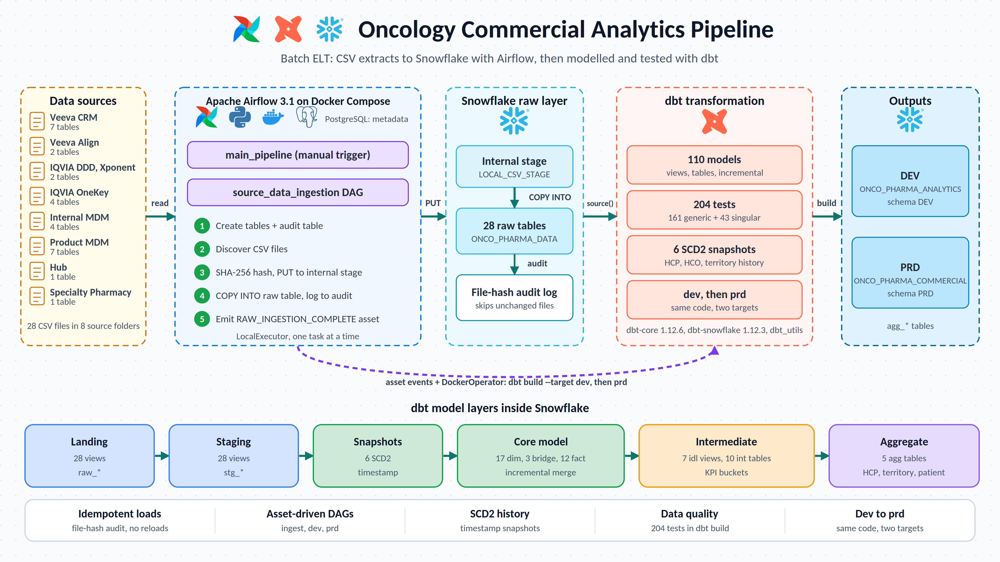

# Onco Pharma Analytics: Snowflake ELT with Airflow and dbt

A batch ELT pipeline for oncology pharma commercial analytics. 
- Raw CSV extracts from eight source systems are loaded into Snowflake by Python 
- Tasks orchestrated with Apache Airflow, then 
- Modelled by dbt into dimensions, facts, patient-journey and HCP/territory KPI tables.


## What It Does

1. **Ingest:** 28 CSVs from `source_data/` are uploaded to a Snowflake internal stage and loaded into typed raw tables. A SHA-256 hash per file is stored in an audit table, so unchanged files are skipped on re-runs.
2. **Transform:** Airflow launches a dbt container that runs `dbt build` on a **dev** target, then on **prd** once dev succeeds.
3. **Output:** 110 models, 6 SCD2 snapshots and 204 tests, ending in analytics-ready `agg_*` tables.

The dataset looks synthetic (fictional company and brand names), though the repo does not state this.

## Architecture

```
CSV files → Python tasks (Airflow) → Snowflake raw tables → dbt (landing → staging → dim/fact → KPI → aggregate)
```



| Layer | Role |
|---|---|
| **Sources** | 28 CSVs in 8 folders (Veeva CRM/Align, IQVIA, IQVIA OneKey, internal MDM, product MDM, Hub, Specialty Pharmacy) |
| **Orchestration** | Airflow 3.1.0 (LocalExecutor) with PostgreSQL 16 metadata DB, run via Docker Compose |
| **Ingestion** | Python: discover files, hash, `PUT` to stage, `COPY INTO` raw tables, write audit row |
| **Warehouse** | Snowflake: raw database, stage, audit table, dbt output databases |
| **Transformation** | dbt project run in a short-lived container started by Airflow's `DockerOperator` |

### Pipeline flow

`main_pipeline` (manual trigger) → `source_data_ingestion` → `dbt_dev_transformation` → `dbt_prd_transformation`

DAGs are chained with Airflow assets (`RAW_INGESTION_COMPLETE`, `DBT_DEV_COMPLETE`), so each stage runs only after the previous one succeeds.

## Tech Stack

| Technology | Role |
|---|---|
| Python 3.12 | Ingestion code and DAGs |
| Apache Airflow 3.1.0 | Orchestration, asset-based scheduling |
| Snowflake | Warehouse, stage, raw and modelled data |
| dbt-core 1.12.6 / dbt-snowflake 1.12.3 | Transformation (plus `dbt_utils`) |
| Docker / Compose | Local runtime; dbt runs as a sibling container |
| PostgreSQL 16 | Airflow metadata |
| uv | Local dependency lock (dbt only) |

## Snowflake Layout

| Database | Contents |
|---|---|
| `ONCO_PHARMA_DATA` | 8 raw schemas, file format and stage in `PUBLIC`, `CONTROL.FILE_INGESTION_AUDIT` |
| `ONCO_PHARMA_ANALYTICS` | dbt **dev** output (`DEV`, `DEV_snapshots`) |
| `ONCO_PHARMA_COMMERCIAL` | dbt **prd** output (`PRD`, `PRD_snapshots`) |

## Repository Structure

```text
├── airflow/dags/          # main_pipeline, ingestion DAG, dbt dev/prd DAGs, assets
├── data_ingestion/        # table DDL, file discovery, stage upload, COPY load
├── utils/                 # config, logger, Snowflake connection
├── snowflake/             # one-off setup.sql plus manual quality/analysis scripts
├── source_data/           # 28 CSVs as <schema>/<table>/<table>.csv
├── docker/                # Airflow and dbt Dockerfiles
├── data_transformation/onco_pharma_analytics_dbt/   # dbt project (see its README)
└── docker-compose.yml
```

## Key Design Decisions

- **ELT, not ETL:** ingestion does no business logic; all modelling runs in Snowflake via dbt.
- **Idempotent loading:** content-hash audit table plus content-addressed stage paths make re-runs safe.
- **Dev before prd:** the same dbt code is promoted through two targets, gated by asset dependencies.
- **SCD2 history:** dbt snapshots feed the master dimensions.
- **Incremental facts:** merge strategy on unique keys.
- **Serialized ingestion:** concurrency is limited to one task at a time by design.

## Configuration

Credentials and settings come from a git-ignored `.env` file (no `.env.example` exists). It covers Snowflake connection details, the raw/dev/prd database names, allowed schemas, file format, stage, and the Airflow Postgres and JWT secrets. Note that one variable is spelled `SNOWFLAKE_SOURCE_DATA_DATABSE` in the code and must be used exactly.

**Before running:** run `snowflake/setup.sql` once, and replace the hard-coded `E:/Projects/...` dbt bind-mount path in both dbt DAG files with your own host path.

## Testing and Data Quality

- **Ingestion:** hash-based idempotency, `ON_ERROR=ABORT_STATEMENT`, column-count validation, path-layout checks.
- **dbt:** 161 generic tests and 43 enabled singular tests (SCD2 integrity, reconciliation, chronology). Two further tests are disabled until their external tables exist.
- **Python tests:** none.

Counts come from `dbt parse`; pass/fail outcomes are not yet observed.

## Security Notes

- No hard-coded credentials found; secrets live only in `.env`.
- The Snowflake password is passed to the dbt container as an environment variable, and the Docker socket is mounted into Airflow, which gives effective host-level control.
- One shared user and role is used for ingestion, dev and prd (no least-privilege separation).
- `source_data/` (~175 MB) is not git-ignored.

## Known Limitations

- No CI/CD, `.env.example`, Python tests or linting.
- Hard-coded host path in the dbt DAGs.
- `sqlparse` is not listed explicitly in the Airflow image, and `Dockerfile.dbt` has a stray `COPY` line that will likely fail (both unverified).
- Neither Dockerfile pins versions to `uv.lock`.
- dbt re-runs on every ingestion run, even if all files were skipped.
- No schedule and no retries on DAGs.
- No dbt model descriptions or source freshness checks.
- No BI or consumption layer.
- No `LICENSE` or author metadata yet.

## Next Steps

Environment-driven mount path, pinned image versions, secrets management, a CI job running `dbt parse`/`dbt build`, model descriptions for `dbt docs`, and a defined schedule.

## Related Docs

dbt project details: [`data_transformation/onco_pharma_analytics_dbt/README.md`](data_transformation/onco_pharma_analytics_dbt/README.md)